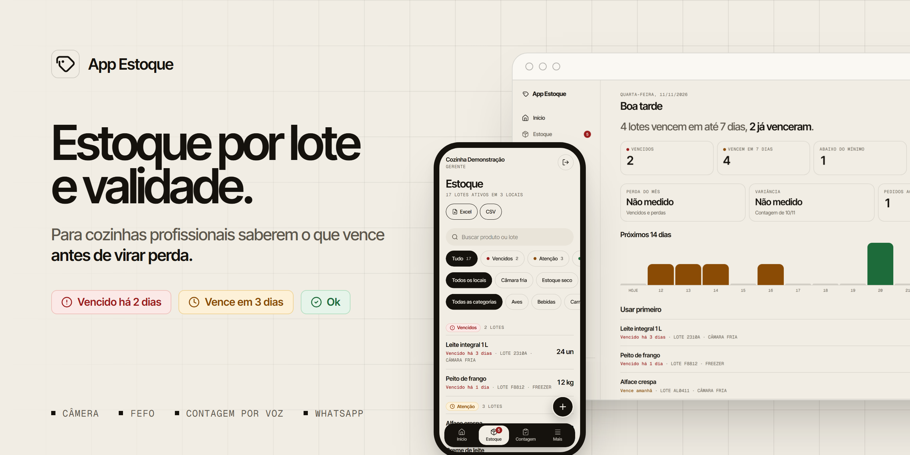
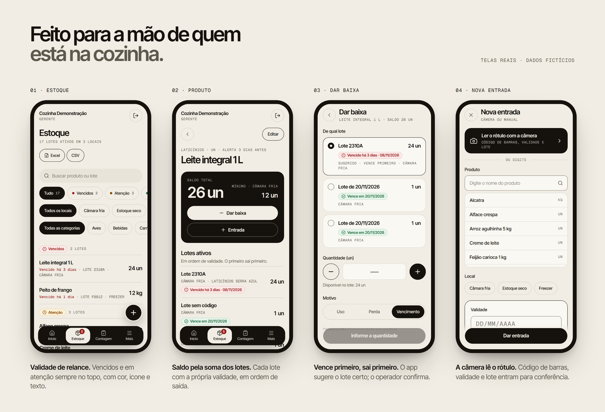
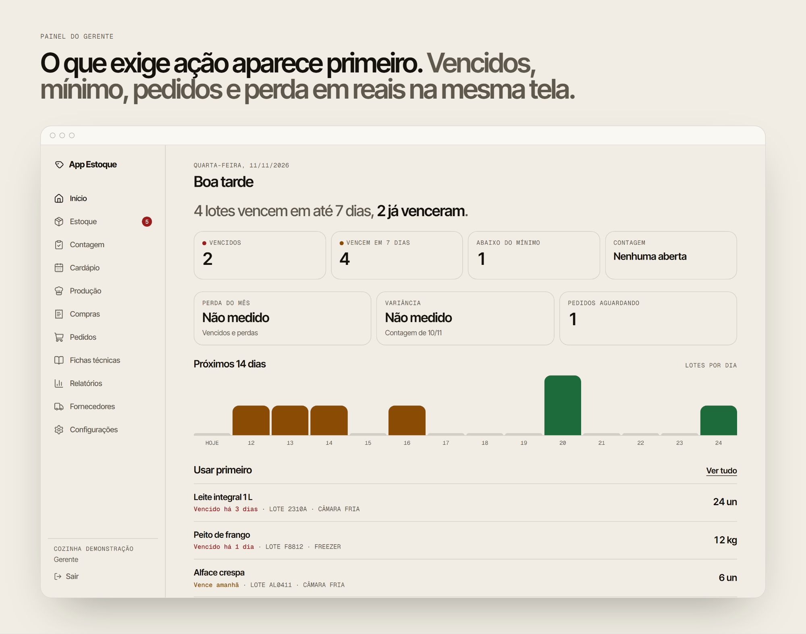

  

## App Estoque

O App Estoque controla o estoque de alimentos por lote e validade. Foi pensado para restaurantes, cozinhas industriais, refeitórios e lanchonetes.

Na maioria dessas cozinhas, o estoque ainda fica numa planilha ou no papel. Ninguém sabe ao certo qual lote vence primeiro, o desperdício não é medido e a contagem leva horas. O App Estoque mostra o que precisa ser usado antes de vencer, indica qual lote deve sair primeiro e mostra quanto foi perdido em reais.

Ele roda no navegador do celular e do computador e pode ser instalado na tela inicial, sem passar pela loja de aplicativos.

  

### No dia a dia da cozinha

Quando a mercadoria chega, a câmera do celular lê o código de barras, a validade e o lote do rótulo. A leitura acontece no próprio aparelho, e quem recebe só confere a data e confirma. Cada entrada vira um lote com a sua validade.

Na tela de estoque, a validade aparece em cores: vermelho para o que já venceu, âmbar para o que vence em poucos dias e verde para o resto. Cada cor vem com ícone e texto, e o que precisa de atenção fica no topo.

Na hora de usar um produto, o app sugere o lote que vence primeiro, e o operador confirma ou escolhe outro. A contagem de estoque é feita com botões grandes de mais e menos, ou falando ("arroz, cinco quilos e meio"). As diferenças viram ajustes com motivo e ficam registradas.

### Para quem gerencia

  

O painel reúne o que vence nos próximos dias, os itens abaixo do mínimo, os pedidos esperando aprovação e a perda do mês. O gerente também pode:

- importar o XML da nota fiscal do fornecedor e criar todos os lotes de uma vez;
- acompanhar o preço de cada produto por fornecedor e calcular o custo de cada prato pela ficha técnica;
- montar o cardápio da semana e a lista de produção do dia;
- receber uma sugestão de pedido de compra, que só vale depois de aprovada por uma pessoa;
- exportar o estoque e os relatórios de perda em Excel, CSV e PDF.

Também dá para consultar o estoque e registrar baixas pelo WhatsApp, por texto, áudio ou foto do rótulo. O assistente sempre mostra o que vai registrar e só grava depois de um "sim".

### Segurança e privacidade

Cada empresa só enxerga os próprios dados, e essa regra é aplicada no banco de dados, não só na tela. O acesso é por convite, com perfis de dono, gerente e operador, e verificação em duas etapas.

As movimentações de estoque não podem ser editadas nem apagadas: um erro é corrigido com um estorno, e o histórico mostra quem fez o quê e quando. Nenhuma rotina automática altera o estoque ou envia pedido sem aprovação. A área logada não tem rastreadores de marketing, e o tratamento de dados segue a LGPD.

O projeto passou por testes de invasão ao fim de cada etapa e por um teste completo antes do piloto, e todos os problemas encontrados foram corrigidos.

### Situação atual

O App Estoque está em piloto. O código-fonte é privado, e as imagens desta página mostram telas reais com dados fictícios.

Para conhecer o produto ou pedir uma demonstração, escreva para o e-mail desta organização, que aparece no topo da página.

© 2026 App Estoque. Todos os direitos reservados.
